  

  

  
  
  
  <!--  -->

 

## ✦ About me

I'm an **AI & Data Science undergraduate at Egypt-Japan University of Science & Technology (E-JUST)** who likes building things that actually run. I care about the parts most people skip: preprocessing, feature engineering, and evaluating with the metric that matters for the domain (WER/CER for speech, FID for generative models, AUC-ROC and F1 for classification).

- 🤖 Currently building **multi-agent LLM systems** with planning, tool calling and self-critique loops
- 🎙️ Fine-tuned **Whisper** on Egyptian Arabic and trained a custom **CNN + Bi-LSTM + CTC** ASR from scratch
- 🔬 Medical imaging, EEG biometrics and generative AI for scarce data
- 🌱 Learning more about **CI/CD, MLOps and deployment**
- 📍 Alexandria, Egypt · open to **AI / ML engineering internships**

 

## ✦ Featured projects

| | Project | What it does | Highlights |
|:-:|---|---|---|
| 🤖 | **[Reflective Research Agent](https://github.com/RahmaDawy)** | Planner, tool-calling researcher, writer and self-review editor agents that produce cited research reports | Self-critique loop · parallel tasks · retry/backoff · FastAPI · PostgreSQL · Docker |
| 🎙️ | **[Arabic Whisper ASR](https://huggingface.co/spaces/RahmaDawi/arabic-asr-demo)** | Whisper-small fine-tuned on 15K Egyptian Arabic samples, with a live Gradio demo | WER / CER · fp16 · SpecAugment · live on HF Hub |
| 🎧 | **[CNN + Bi-LSTM CTC ASR](https://huggingface.co/spaces/RahmaDawi/arabic-asr-demo-lstm)** | Character-level Arabic ASR built from scratch | 120-dim MFCC · CTC loss · auto checkpointing |
| 🩸 | **[Blood Cell Classification](https://github.com/RahmaDawy)** | 8-class classifier fusing deep and handcrafted features | **86.25%** acc · **0.986** AUC-ROC · κ 0.843 |
| 🫁 | **[Chest X-Ray Diffusion](https://github.com/RahmaDawy)** | Latent diffusion model for synthetic pneumonia X-rays | FID scored · downstream classifier lift |
| 🧠 | **[EEG Biometric ID](https://github.com/RahmaDawy/EEG-Biometric-Identification-Using-CNN-RNN)** | Identifies 109 subjects from resting-state EEG with a CRNN | **97%** acc · F1 0.97 · STFT spectrograms |
| ☀️ | **[Solar PV Forecasting](https://github.com/RahmaDawy/Solar-Power-Prediction-Egypt)** | Power forecasting for Aswan, Egypt from sensor data | R² 0.70 · Willmott 0.91 · PCA / SVD / LDA |

 

## ✦ Tech stack

**AI & ML**

  
  
  
  
  
  
  

**Backend & DevOps**

  
  
  
  
  
  
  

**Languages & Data**

  
  
  
  
  
  
  
  

 

## ✦ GitHub stats

  
  

 

<i>✦ Let's build something that ships.</i>

